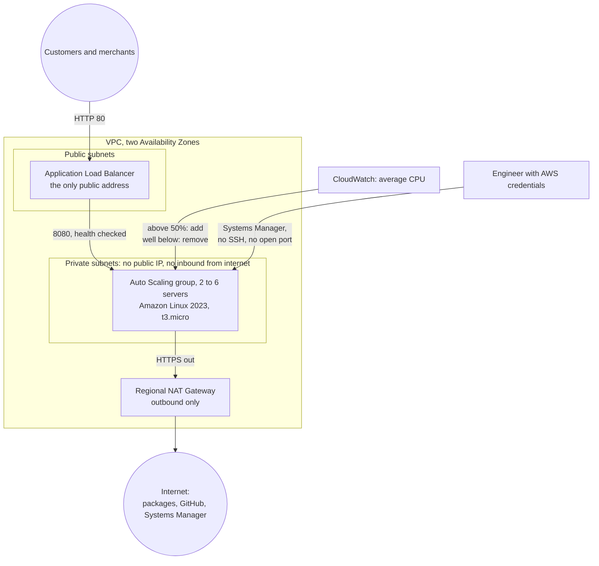

# onward-salesday

The Onward Logistics order system on servers that grow and shrink with
demand. On a sales day, order volume triples within hours: this setup adds
servers by itself when they get busy and removes them when the rush is over.

One repository holds both the application and its infrastructure. A push to
`main` is the deployment (CloudFormation GitSync). Nothing is created in the
console.

## How the pieces fit together



- **Customers** reach one address: the load balancer. It shares requests across healthy servers.
- **Servers** sit in private subnets. Nothing on the internet can connect to them. They connect *out* through the NAT gateway to download what they need.
- **The Auto Scaling group** keeps between two and six servers running, spread over two zones. It replaces any server that fails its health check.
- **A scaling policy** watches average CPU. Above 50% it adds servers; when CPU stays low it removes them.
- **Each server builds itself** at launch: it downloads this repository and runs `scripts/install.sh`. Nobody logs in.
- **The page shows which server answered** (instance ID and zone), so you can watch requests spread as servers come and go.

## What is in this repository

| Path | What it is |
|---|---|
| `infra/template.yaml` | The whole infrastructure, in seven numbered sections |
| `infra/deployments/dev.yaml` | GitSync deployment file: parameters and tags for the `dev` stack |
| `bootstrap/` | The two templates that switch GitSync on. Deployed once from a terminal |
| `app/` | The order application: `orders.py` (logic), `routes.py` (pages and API), `runtime.py` (which server am I) |
| `scripts/install.sh` | Run by every new server to install and start the application |
| `scripts/load-test.sh` | Simulates a sales day, securely |
| `tests/` | Application tests |
| `docs/decisions.md` | Each design decision, its reason, and what was rejected |
| `docs/cost.md` | What the design costs on a quiet day and on a peak day |

## Changing something

| To change | Edit | What happens after merging to `main` |
|---|---|---|
| Number or size of servers, CPU target | `infra/deployments/dev.yaml` | GitSync updates the stack |
| The infrastructure | `infra/template.yaml` | GitSync updates the stack |
| The application | `app/`, then tag the commit and set `AppVersion` to the tag in `infra/deployments/dev.yaml` | Servers are replaced one at a time with the new version, never dropping below two |

`AppVersion: main` works for a first deployment, but a server launched later would install whatever `main` is at that moment. Use tags once you make changes, so every server runs the same code.

## Running the application locally

```bash
python3 -m venv .venv && source .venv/bin/activate
pip install -r requirements-dev.txt
pytest
flask --app wsgi run --port 8080
```

## Building from scratch

You need the AWS CLI signed in to the target account. This repository must be **public** on GitHub, because servers download it without credentials.

```bash
ENV=dev
OWNER="Jordan Steve"
```

**1. Create the GitHub connection** (skip if the account already has an approved one, and use its ARN in step 3).

```bash
aws cloudformation deploy \
  --stack-name onward-$ENV-salesday-connection \
  --template-file bootstrap/connection.yaml \
  --parameter-overrides Environment=$ENV Owner="$OWNER" \
  --tags Project=onward Environment=$ENV Owner="$OWNER"
```

**2. Approve the connection.** In the AWS console open *Developer Tools → Settings → Connections*, select `onward-dev-salesday`, choose *Update pending connection* and grant access to this repository. GitHub requires a person to do this once; it cannot be automated.

**3. Switch on GitSync.** This creates the `onward-dev-salesday` stack from `main`.

```bash
CONNECTION_ARN=$(aws cloudformation describe-stacks --stack-name onward-$ENV-salesday-connection \
  --query "Stacks[0].Outputs[?OutputKey=='ConnectionArn'].OutputValue" --output text)

aws cloudformation deploy \
  --stack-name onward-$ENV-salesday-gitsync \
  --template-file bootstrap/gitsync.yaml \
  --capabilities CAPABILITY_NAMED_IAM \
  --parameter-overrides Environment=$ENV Owner="$OWNER" \
      ConnectionArn=$CONNECTION_ARN \
      GitHubOwner=danjor667 RepositoryName=onward-salesday \
  --tags Project=onward Environment=$ENV Owner="$OWNER"
```

**4. Open the application** once the stack reaches `CREATE_COMPLETE` (about five minutes).

```bash
aws cloudformation describe-stacks --stack-name onward-$ENV-salesday \
  --query "Stacks[0].Outputs[?OutputKey=='ApplicationUrl'].OutputValue" --output text
```

### To confirm on the first real deployment

The templates pass `cfn-lint`, and the install script was run successfully in an Amazon Linux 2023 container, but the stack has not yet been deployed to an account. Watch for:

- **GitSync creating the stack.** Step 3 assumes a new sync configuration creates its stack straight away. If it does not appear, push a commit that touches `infra/deployments/dev.yaml`.
- **The role GitSync deploys with.** It carries the deployment permissions itself (`onward-dev-salesday-deploy`). If the stack fails with an access error, add the missing action to that policy in `bootstrap/gitsync.yaml`.
- **Servers not becoming healthy.** Open a session on one (see below) and read `/var/log/cloud-init-output.log`.

## Proving the client's checks

```bash
URL=$(aws cloudformation describe-stacks --stack-name onward-dev-salesday \
  --query "Stacks[0].Outputs[?OutputKey=='ApplicationUrl'].OutputValue" --output text)
```

| Check | How to show it |
|---|---|
| One public address, stays reachable | Open `$URL`. Keep `while true; do curl -s -o /dev/null -w "%{http_code}\n" $URL; sleep 1; done` running through the other checks |
| Requests shared, page shows the server | `for i in $(seq 8); do curl -s $URL/health; echo; done` shows different `server` values. The page header shows the same |
| Grows under demand, shrinks afterwards | `scripts/load-test.sh 600`. Servers are added within about three to five minutes. Roughly fifteen minutes after the load ends they are removed |
| Failed server is replaced | `aws ec2 terminate-instances --instance-ids <id>`: the page keeps answering and a new server appears |
| Survives the loss of a zone | Servers run in two zones (shown on the page). Terminate every server in one zone: the other zone keeps answering while replacements start |
| Only the load balancer is public | Servers have no public IP (`aws ec2 describe-instances --filters Name=tag:Name,Values=onward-dev-salesday --query "Reservations[].Instances[].[InstanceId,PublicIpAddress]"`). The server security group accepts only the load balancer, and no group has port 22 |
| Servers can still download updates | They installed Python packages from the internet at launch. From a session: `curl -sI https://pypi.org | head -1` |
| No admin ports | `aws ssm start-session --target <instance-id>` opens a shell with no SSH key and no open port (needs the Session Manager plugin for the AWS CLI) |
| Rebuilt from the repository | The four steps above |

## Removing everything

1. Delete the `onward-dev-salesday` stack.
2. Delete `onward-dev-salesday-gitsync`, then `onward-dev-salesday-connection`.

Do not push to `main` between steps 1 and 2: GitSync would create the stack again.
