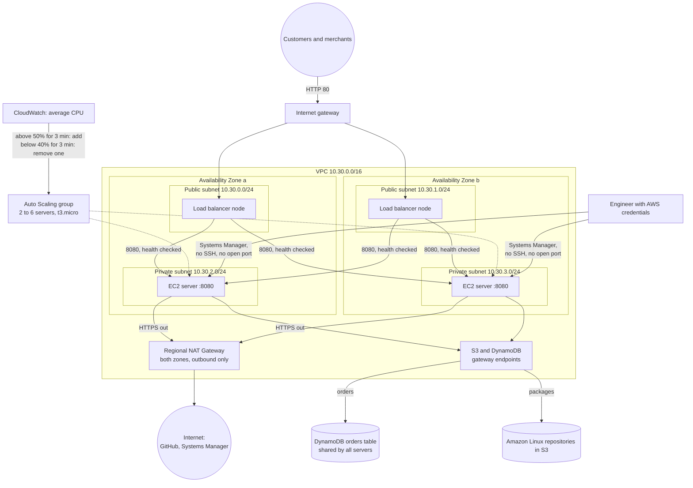
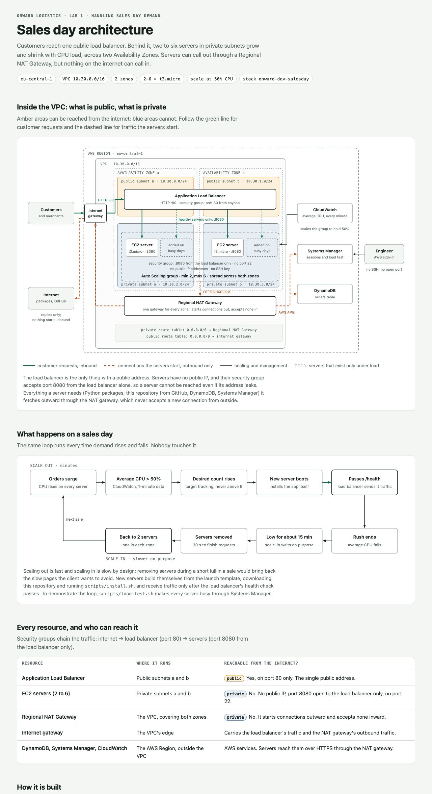

# onward-salesday

The Onward Logistics order system, where customers book and track parcel
deliveries, on servers that grow and shrink with demand. On a sales day, order volume triples within hours: this setup adds
servers by itself when they get busy and removes them when the rush is over.

One repository holds both the application and its infrastructure. A push to
`main` is the deployment (CloudFormation GitSync). Nothing is created in the
console.

## How the pieces fit together



- **Customers** reach one address: the load balancer. AWS runs a node of it in each zone's public subnet (drawn separately above), and either node can send requests to healthy servers in both zones.
- **Servers** sit in private subnets. Nothing on the internet can connect to them. They connect *out* through one Regional NAT Gateway, which serves both zones. Orders (DynamoDB) and packages (S3) go through free gateway endpoints and never leave the AWS network.
- **The network follows the VPC lab** (`onward-orders` network): public subnets for the load balancer, private subnets for servers, and gateway endpoints. Instead of the VPC lab's NAT gateway per zone, it uses one Regional NAT Gateway, which spans both zones by itself: no Elastic IPs and one private route table.
- **The Auto Scaling group** keeps between two and six servers running, spread over two zones. It replaces any server that fails its health check.
- **Two scaling rules** watch average CPU. Above 50% for 3 minutes, servers are added; below 40% for 3 minutes, one server is removed at a time.
- **Each server builds itself** at launch: it downloads this repository and runs `scripts/install.sh`. Nobody logs in.
- **Every page shows which server answered** (instance ID and zone), so you can watch requests spread as servers come and go.
- **Orders live in one DynamoDB table** shared by all servers, so an order placed through one server is found by every other, including servers that did not exist when it was placed.



## What is in this repository

| Path | What it is |
|---|---|
| `infra/template.yaml` | The whole infrastructure, in six numbered sections |
| `infra/deployments/dev.yaml` | GitSync deployment file: parameters and tags for the `dev` stack |
| `bootstrap/` | The two templates that switch GitSync on. Deployed once from a terminal |
| `app/` | The order application (see below) |
| `scripts/install.sh` | Run by every new server to install and start the application |
| `scripts/load-test.sh` | Simulates a sales day, securely |
| `tests/` | Application tests |
| `docs/discovery-report.docx` | Discovery report (Word): the problem, options considered, the business value and the key design decisions |
| `docs/architecture.png` | Architecture diagram, exported from Eraser |
| `docs/architecture.eraser` | Source of the diagram: paste into [Eraser](https://www.eraser.io) to edit and re-export |
| `docs/cost.md` | What the design costs on a quiet day and on a peak day |

### Inside `app/`

| Path | What it is |
|---|---|
| `app/pricing.py` | What a delivery costs and how long it takes: route × parcel size × speed |
| `app/orders.py` | The rules for placing, moving and cancelling an order |
| `app/store.py` | Where orders are kept: in memory locally, in DynamoDB on AWS |
| `app/stats.py` | Numbers and search for the operations dashboard |
| `app/security.py` | Form tokens and the staff passcode |
| `app/runtime.py` | Which container or server answered, shown on every page |
| `app/web/` | The pages: `customer.py` (book, track, cancel), `ops.py` (staff dashboard), `api.py` (JSON API and `/health`) |
| `app/templates/`, `app/static/` | The user interface |
| `tests/` | Tests for each of the above. DynamoDB is simulated, so no AWS account is needed |

## What the application does

**Customers and merchants**

- Book a delivery in three steps: route, parcel, people. The price updates as they choose.
- Get a tracking code (for example `ONW-7KQ2MX`) and follow the parcel on a timeline, with an estimated delivery time.
- Cancel an order until a rider has picked it up.
- See their recent orders on the home page.

**Riders and staff** (the *Operations* link, behind a passcode)

- A dashboard: orders in progress, placed and delivered today, revenue, orders by status.
- Search and filter orders, move a parcel to its next step, cancel an order.

Two sample orders always exist, `ONW-DEMO01` and `ONW-DEMO02`, so tracking can be shown straight away.

### The staff passcode

- **Locally** it is `onward-local` (or the `STAFF_PASSCODE` environment variable).
- **On AWS** it is generated the first time the application starts and kept in the orders table, so it is never in this repository. Read it with AWS credentials:

  ```bash
  aws dynamodb get-item --table-name onward-dev-salesday \
    --key '{"pk":{"S":"CONFIG"}}' --query Item.staff_passcode.S --output text
  ```

  To change it, delete that item and restart the application.

## Changing something

| To change | Edit | What happens after merging to `main` |
|---|---|---|
| Number or size of servers, CPU target | `infra/deployments/dev.yaml` | GitSync updates the stack |
| The infrastructure | `infra/template.yaml` | GitSync updates the stack |
| The application | `app/`, then tag the commit and set `AppVersion` to the tag in `infra/deployments/dev.yaml` | Servers are replaced one at a time with the new version, never dropping below two |

`AppVersion: main` works for a first deployment, but a server launched later would install whatever `main` is at that moment. Use tags once you make changes, so every server runs the same code.

## Running the application locally

```bash
python3 -m venv .venv && source .venv/bin/activate
pip install -r requirements-dev.txt
pytest
flask --app wsgi run --port 8080
```

Locally, orders are kept in memory and are lost when the application stops.

## Building from scratch

You need the AWS CLI signed in to the target account. This repository must be **public** on GitHub, because servers download it without credentials.

```bash
ENV=dev
OWNER="Jordan Steve"
```

**1. Create the GitHub connection** (skip if the account already has an approved one, and use its ARN in step 3).

```bash
aws cloudformation deploy \
  --stack-name onward-$ENV-salesday-connection \
  --template-file bootstrap/connection.yaml \
  --parameter-overrides Environment=$ENV \
  --tags Project=onward Environment=$ENV Owner="$OWNER"
```

**2. Approve the connection.** In the AWS console open *Developer Tools → Settings → Connections*, select `onward-dev-salesday`, choose *Update pending connection* and grant access to this repository. GitHub requires a person to do this once; it cannot be automated.

**3. Switch on GitSync.** This creates the `onward-dev-salesday` stack from `main`.

```bash
CONNECTION_ARN=$(aws cloudformation describe-stacks --stack-name onward-$ENV-salesday-connection \
  --query "Stacks[0].Outputs[?OutputKey=='ConnectionArn'].OutputValue" --output text)

aws cloudformation deploy \
  --stack-name onward-$ENV-salesday-gitsync \
  --template-file bootstrap/gitsync.yaml \
  --capabilities CAPABILITY_NAMED_IAM \
  --parameter-overrides Environment=$ENV \
      ConnectionArn=$CONNECTION_ARN \
      GitHubOwner=danjor667 RepositoryName=onward-salesday \
  --tags Project=onward Environment=$ENV Owner="$OWNER"
```

**4. Create the empty stack for Git sync to take over.** Git sync only updates stacks that already exist, so the stack is created once from a placeholder template. Git sync then replaces it with `infra/template.yaml` on the next commit that touches `infra/deployments/dev.yaml` or the template.

```bash
aws cloudformation deploy \
  --stack-name onward-$ENV-salesday \
  --template-file bootstrap/placeholder.yaml \
  --tags Project=onward Environment=$ENV Owner="$OWNER"
```

Then push any change to `infra/deployments/dev.yaml` (a comment is enough) to start the first sync.

**5. Open the application** once the stack reaches `UPDATE_COMPLETE` (about five to ten minutes).

```bash
aws cloudformation describe-stacks --stack-name onward-$ENV-salesday \
  --query "Stacks[0].Outputs[?OutputKey=='ApplicationUrl'].OutputValue" --output text
```

### To confirm on the first real deployment

The templates pass `cfn-lint`, and the install script was run successfully in an Amazon Linux 2023 container, but the stack has not yet been deployed to an account. Watch for:

- **The role GitSync deploys with.** It carries the deployment permissions itself (`onward-dev-salesday-deploy`). If the stack fails with an access error, add the missing action to that policy in `bootstrap/gitsync.yaml`.
- **Servers not becoming healthy.** Open a session on one (see below) and read `/var/log/cloud-init-output.log`.

## Proving the client's checks

```bash
URL=$(aws cloudformation describe-stacks --stack-name onward-dev-salesday \
  --query "Stacks[0].Outputs[?OutputKey=='ApplicationUrl'].OutputValue" --output text)
```

| Check | How to show it |
|---|---|
| One public address, stays reachable | Open `$URL`. Keep `while true; do curl -s -o /dev/null -w "%{http_code}\n" $URL; sleep 1; done` running through the other checks |
| Requests shared, page shows the server | `for i in $(seq 8); do curl -s $URL/health; echo; done` shows different `answered_by` values. The footer of every page shows the same. Place an order, then refresh its tracking page: different servers answer, and each one finds the order |
| Grows under demand, shrinks afterwards | `scripts/load-test.sh 600`. Servers are added within about three to five minutes. About three minutes after the load ends they start being removed, one at a time |
| Failed server is replaced | `aws ec2 terminate-instances --instance-ids <id>`: the page keeps answering and a new server appears |
| Survives the loss of a zone | Servers run in two zones (shown on the page). Terminate every server in one zone: the other zone keeps answering while replacements start |
| Only the load balancer is public | Servers have no public IP (`aws ec2 describe-instances --filters Name=tag:Name,Values=onward-dev-salesday --query "Reservations[].Instances[].[InstanceId,PublicIpAddress]"`). The server security group accepts only the load balancer, and no group has port 22 |
| Servers can still download updates | They installed Python packages from the internet at launch. From a session: `curl -sI https://pypi.org | head -1` |
| No admin ports | `aws ssm start-session --target <instance-id>` opens a shell with no SSH key and no open port (needs the Session Manager plugin for the AWS CLI) |
| Rebuilt from the repository | The five steps above |

## Removing everything

1. Delete the `onward-dev-salesday` stack. This also deletes the orders table and its orders.
2. Delete `onward-dev-salesday-gitsync`, then `onward-dev-salesday-connection`.

Do not push to `main` between steps 1 and 2: GitSync would create the stack again.
